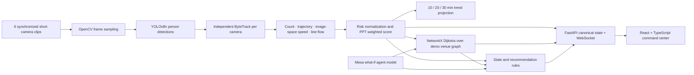

# CrowdShield AI — IS-15

**AI-powered crowd mobility simulation and management platform** · SISTec Innovation Hackathon 2026

CrowdShield is a local decision-support prototype that follows the presentation flow:

**OBSERVE → UNDERSTAND → PREDICT → SIMULATE → RECOMMEND → OPTIMIZE**

It processes six fixed, synchronized WILDTRACK camera views, runs YOLOv8n person detection with one persistent ByteTrack tracker per view, calculates camera-level crowd measurements, applies the PPT risk weights in Python, predicts short-term view load, plans a route on a configurable NetworkX graph, evaluates interventions, and publishes one canonical state over REST and WebSocket to a React command dashboard.

This is a hackathon demonstration and operator aid. The configured ETH courtyard topology, view capacities, counting lines, movement/exit rates and agent behavior are illustrative. It is not a surveyed venue map, certified evacuation calculator, automated dispatch system, or control system for physical gates.

## Architecture



### Where the stages live

| Stage | Implementation |
|---|---|
| Observe | `backend/app/cv/manager.py`: six config-created OpenCV workers; YOLOv8n person class; independent ByteTrack state; one inference sample per configured interval. |
| Understand | `backend/app/metrics/engine.py`: tracked counts, active trajectories, normalized image-space virtual line crossing, directional flow, screen direction and pixel speed. |
| Risk | `backend/app/risk/engine.py`: configurable normalization, 0–100 clamping and the PPT's `0.40 density + 0.25 flow + 0.20 capacity + 0.15 evacuation time` formula. |
| Predict | `backend/app/prediction/engine.py`: bounded linear projection from observed short-window count slope at 10, 20 and 30 minutes. It is labelled as a heuristic; no trained XGBoost model or accuracy claim is made. |
| Simulate | `backend/app/simulation/engine.py`: Mesa agents seeded from observed per-view counts; gate, exit, incident, crowd and weather scenario changes apply to the graph/model. Camera overlaps are collapsed with max-per-node before agents are created. |
| Recommend | `backend/app/recommendations/engine.py`: deterministic state/trend/routing rules; action priorities, reason and expected effect; safe state returns no intervention. |
| Optimize | `backend/app/routing/planner.py`: NetworkX weighted Dijkstra with distance, congestion, view risk and travel-time costs; closed gates and blocked exits are removed from the graph. |
| Display | `frontend/src/pages/`: charcoal-and-brass command center with six native video players, live measurements/risk, forecast, route, active measures, what-if comparison, PostgreSQL status and report export. |

## Six-camera data and the 2 GB limit

The six feeds are synchronized WILDTRACK views of the ETH Zurich courtyard. The [official EPFL dataset page](https://www.epfl.ch/labs/cvlab/data/data-wildtrack/) reports 1920×1080 camera recordings at 60 fps, synchronized camera views and annotations at 2 fps. These are six actual viewpoints of the same space; they are not assigned fabricated names such as a specific entrance or gate where the source does not identify one.

The original camera files are about 7.4 GB each. **The project never downloads a full camera original.** `scripts/fetch_wildtrack_samples.py` asks FFmpeg to transcode 15 seconds from each official source through a local HTTP byte-range proxy. The proxy rejects ranges after an 1.85 GB aggregate transfer budget. The script checks the six stored outputs against a 2,000 MB cap. This prepared run stores six H.264 excerpts at 640×360, 10 fps, without audio; their combined size is 3.37 MB. `data/videos/asset_manifest.json` records actual size, duration, resolution, frame rate and duration for each clip.

The source page links to the dataset but does not provide a clear redistribution license on that page. The source repository ignores generated binaries; this prepared MVP ZIP includes the original six short excerpts, the two separately licensed alternate six-clip sets, and 6.55 MB YOLOv8n weights so it can run without transferring the multi-gigabyte originals. Review WILDTRACK's current terms before distributing those six clips or presenting their results publicly, and cite the source. The alternate event and railway clip licenses are recorded in their attribution files. Ultralytics' licensing terms also apply to YOLOv8; check the [Ultralytics licensing page](https://www.ultralytics.com/license) for the intended use.

View roles are honestly named `Courtyard View 01` through `06`. The source does not include a surveyed gate/zone layout. The demo graph and capacities in `configs/venue.yaml` are engineering assumptions to demonstrate graph behavior, not claimed facts about the ETH site. Each camera maps to a camera-view zone. Overlapping views may see the same person: the UI identifies risk as view-level; the global score is the maximum view risk, and graph counts use maximum-per-node instead of summing camera views. There is no cross-camera re-identification.

## Switch all six videos by changing the operator ID

The ZIP contains three six-video sets (18 clips total). Every clip is a short H.264 MP4 at 640×360 and 10 fps, with audio removed. The operator profile selects the matching set automatically; there is no YAML edit, code change, or server restart.

| Operator ID | Active six-video set |
|---|---|
| **Devansh Singh Bais** | Original ETH Zurich Courtyard WILDTRACK clips |
| **Amrendra Sharma** | Indian religious event samples |
| **Namish Jain** | Indian railway station and train samples |

To switch, open the profile menu at the top right, choose **View / edit profile**, select one of the three IDs, and save. The backend immediately changes all six camera inputs and starts their measurements from the new clips. Choose **Devansh Singh Bais** to return to the original Zurich set. These profiles are demo identities, not sign-in accounts.

The religious and railway sets use short public recordings with the licenses listed beside each clip in `data/videos/sets/religious/ATTRIBUTION.md` and `data/videos/sets/railway_india/ATTRIBUTION.md`. They are event/train samples, **not CCTV feeds**. The demo graph, zone layout, capacities and recommendations remain illustrative and are not real operational guidance for those locations.

## Risk, metrics and decisions

The PPT specifies weights but not normalization equations. This prototype makes the following adjustable demonstration choices in `configs/risk.yaml` and `configs/routing.yaml`:

- **Density score:** per-view tracked person count divided by a configurable reference count (42 by default), clamped to 0–100. There is no camera-to-metre calibration, so the UI reports “View load,” never people/m².
- **Flow score:** line-crossings per rolling 60 seconds divided by a configurable reference rate (30/min by default). Lines are normalized image coordinates in `configs/cameras.yaml`; their orientation must be calibrated for another venue.
- **Capacity score:** view count divided by that view's illustrative configured capacity, clamped to 0–100.
- **Evacuation-time score:** estimated view count divided by configured assumed exit throughput, normalized to a 12-minute reference and clamped. It is an unvalidated demo estimate.
- **Risk:** the exact PPT-weighted sum of the four normalized components, clamped to 0–100.
- **State boundaries:** `[0,30)` SAFE, `[30,60)` WARNING, `[60,80)` HIGH and `[80,100]` CRITICAL.
- **Global state:** the highest camera-view risk, never an average of non-comparable views. It is expressly not a unique-person venue total.
- **Trend:** slope across up to 30 seconds of sampled per-view counts, clipped to ±1% of view capacity per minute. Projected counts are bounded from zero to twice configured view capacity; it is not model training.
- **ROI, entry/exit and direction:** each config-created camera has a normalized polygon ROI in `configs/cameras.yaml` (the current default is the whole frame until the courtyard view is manually calibrated). Detections outside the configured polygon do not enter that view's count. Track crossing of the configured normalized virtual line increments a per-camera direction counter once per observed crossing. Direction labels are screen-relative LEFT/RIGHT/UP/DOWN, not compass labels. Pixel displacement is reported in px/s because no physical calibration is provided.
- **Actions:** the backend emits no intervention for SAFE. Warning actions require trend conditions. Higher states can produce rule-triggered flow redirection, operator advisories, staffing preparation or a route action, with the condition and expected effect attached. The interface labels these as recommendations for people to review.

## What-if model

The scenario control posts a REST request to the backend. Mesa creates anonymous agents from current measurements, removes or changes graph edges for the selected scenario, and steps them through available connections subject to configured edge throughput. The response includes before/after risk, route, gates, simulation step counts and resulting agent movements. Scenarios include closing Gate A, opening alternate D, blocking Exit B, emergencies, medical incident, power failure, rain and a clearly marked simulated crowd buildup. They change the simulation result only; they never change physical hardware. Synthetic additions used by a scenario are flagged in the response.

## API

- `GET /health` — service and camera reporting summary.
- `GET /api/state` — canonical state snapshot.
- `GET /api/cameras` — camera telemetry.
- `GET /api/events` — state/recommendation/route/simulation event history for this run.
- `GET /api/config` — public risk thresholds, configured views and scenario list.
- `POST /api/operator` — choose a demo operator ID and switch all six active sample videos.
- `POST /api/simulate` — body `{ "scenario_id": "block_exit_b", "steps": 10 }`.
- `POST /api/simulation/clear` — clear the displayed what-if result.
- `POST /api/gates/{gate_id}/{OPEN|CLOSED|RESTRICTED}` — changes only the software graph state; no hardware command.
- `WS /ws/live` — complete canonical state sent once per second. The frontend reconnects automatically.
- `GET /api/database/status` — reports whether PostgreSQL is disabled, connecting, or connected.
- `GET /api/history/measurements?camera_id=camera_01&limit=300` — persisted aggregate camera measurements.
- `GET /api/history/events?limit=300` — persisted risk, route, recommendation and recovery events.
- `GET /api/history/simulations?limit=100` — persisted Mesa what-if results.
- `GET /media/camera_01.mp4` … `camera_06.mp4` — locally transcoded prerecorded views.

The canonical object contains timestamp/demo clock, venue risk and state, risk component scores, cameras, zones, forecasts, route, active recommendations, gates, events, simulation result and system/device status. The backend owns every calculation and decision; React renders received state. The dashboard theme is adapted from the supplied reference ZIP and wired to the real API; its sample metrics are not presented as live readings.

## PostgreSQL history

PostgreSQL is an optional local service. Without `CROWDSHIELD_DATABASE_URL`, the demo continues to run and `/api/database/status` reports `disabled`. When configured, the backend creates its tables and indexes on startup, then writes aggregate camera measurements through a bounded background queue so a slow database does not block video inference. It also saves decision events and Mesa scenario results. It does not store video frames, track IDs, or bounding boxes.

1. Install PostgreSQL for Windows from the [official PostgreSQL Windows download page](https://www.postgresql.org/download/windows/). Keep the default port `5432` and remember the password you choose for the `postgres` user.
2. From the project root in PowerShell, run `scripts/configure_postgres.ps1`. It checks that the Windows service is running, asks for the `postgres` password without echoing it, creates the `crowdshield` database when needed, and writes the connection URL into your private `.env` file.
3. Restart the demo with `stop_demo.ps1` and `start_demo.ps1`. Backend startup creates the history tables and indexes.
4. Check **Settings → PostgreSQL history** or `http://127.0.0.1:8000/api/database/status`; when it says `connected`, measurements, events, and what-if results are being stored.

The PostgreSQL server being installed or running does not automatically connect it to CrowdShield. The private `.env` file is deliberately excluded from the project ZIP; run the setup script once on each computer where you want database history enabled. No password is required for the rest of the demo.

The PostgreSQL installer is provided separately from the compact app ZIP. PostgreSQL must be installed and its Windows service running before the app can connect. The initial history schema is created automatically; no SQL script is required.

## Project tree

```text
backend/app/             FastAPI, canonical state, CV and decision modules
backend/app/database.py  Optional PostgreSQL writer and history queries
backend/tests/           Risk, metrics, routing, simulation and API tests
configs/                 Camera, venue graph, risk, route and recommendation rules
data/videos/             Original six clips plus religious and Indian railway sets (18 clips total)
data/videos/sets/        Alternate sample clips and per-source license attributions
frontend/src/             React/Vite command center, theme and API-connected pages
frontend/dist/            Built dashboard served by FastAPI after setup
models/                   Git-ignored YOLOv8n weights
scripts/                  Local setup, PostgreSQL linking, model/video setup and validation
.env.example              Optional PostgreSQL connection-string template
start_demo.ps1            Starts API + production dashboard together and opens browser
stop_demo.ps1             Stops only the CrowdShield server started by start_demo.ps1
```

## Environment and exact direct dependencies

Verified on Windows 11 x64:

- Python **3.14.7**
- Node.js **24.21.0**, npm **11.19.0**
- PyTorch **2.14.0**, torchvision **0.29.0**, Ultralytics **8.4.163**, OpenCV **4.13.0.92**
- FastAPI **0.141.1**, Uvicorn **0.54.0**, Pydantic **2.13.5**
- Psycopg **3.3.6** (binary adapter), python-dotenv **1.2.3**
- NetworkX **3.7**, Mesa **3.5.1**, NumPy **2.3.5**, PyYAML **6.0.3**, imageio-ffmpeg **0.6.0**
- Vite **5.4.21**, React/React DOM **18.3.1**, TypeScript **5.6.3**, Tailwind **3.4.13**, React Router **6.30.1**, Recharts **2.15.4**, Zustand **4.5.7**

Python package versions are pinned in `requirements.txt`, including ByteTrack's `lap` runtime; npm's complete dependency tree is pinned in `frontend/package-lock.json`. Model: **YOLOv8n (`yolov8n.pt`)**; class 0 PERSON; configurable confidence 0.25, IoU 0.45, 640 input and 1-second inference sample interval. CUDA is detected automatically at runtime, otherwise the processor falls back to CPU. On this inspected host, NVIDIA tooling was not found, so measured inference uses CPU. No GPU real-time claim is made.

## One-time setup and run (PowerShell)

For the full Windows/VS Code walkthrough and remote-hosting notes, see [`DEPLOYMENT.md`](DEPLOYMENT.md).

From the project folder:

```powershell
Set-ExecutionPolicy -Scope Process Bypass
.\scripts\setup_demo.ps1
```

This creates `.venv`, installs the pinned Python/npm dependencies, and builds the frontend. The prepared ZIP already includes YOLOv8n and the six short clips; setup verifies and reuses them. If the assets are absent, the scripts fetch the model and byte-range-transcode 15-second excerpts under the 2 GB output cap. Network access is required for dependency installation and for any missing assets. The downloader requires Node.js 24 and the bundled FFmpeg executable supplied by `imageio-ffmpeg`.

Start the dashboard after setup:

```powershell
.\start_demo.ps1
```

It starts FastAPI at `http://127.0.0.1:8000`, which serves the production dashboard and API together, then opens `http://127.0.0.1:8000/app`. Logs are written under `work/runtime_logs`. For development with separate terminals instead:

```powershell
& .\.venv\Scripts\python.exe -m uvicorn backend.app.main:app --host 127.0.0.1 --port 8000
```

In a second terminal:

```powershell
Set-Location frontend
npm run dev
```

Open `http://127.0.0.1:3000/app`; Vite proxies API, WebSocket and video requests to port `8000`.

Stop those two foreground processes with Ctrl+C. Runtime media can be resized/replaced without source changes using relative `configs/cameras.yaml` paths. Change thresholds/capacities/graph in YAML; no Python edits are needed for ordinary venue configuration.

## Validation commands

```powershell
& .\.venv\Scripts\python.exe -m pytest backend\tests -q
& .\.venv\Scripts\python.exe scripts\run_demo_validation.py
Push-Location frontend; npm run build; Pop-Location
```

`run_demo_validation.py` opens all six local clips, runs one YOLOv8n + ByteTrack inference per view, pushes measured frame counts through the backend state engine and checks risk, forecast and route output. This is an initialization smoke measurement only. Continuous camera processing speed must be read from the dashboard's per-camera processing FPS and inference-latency fields during a demo; it depends on the machine.

## Demo sequence

1. Start with the six synchronized courtyard clips; point out the backend WebSocket connection and per-camera tracked counts.
2. Show that each view reports count, rolling line-flow, screen direction, image-space speed, capacity score and risk state.
3. Explain the PPT's 40/25/20/15 risk weighting and the explicit demo normalizations.
4. Show bounded 10/20/30 minute trend projections and note their heuristic status.
5. Point to the route and the Dijkstra cost basis (distance + congestion + risk + travel time).
6. Run **Block Exit B** or **Close Gate A** to compare measured baseline with the Mesa what-if output.
7. Explain that scenario crowd additions are synthetic and all gate/staff/alert items are operator recommendations only.

## Privacy, reliability and known limits

- No face recognition, identity data, or cross-camera person matching. Track IDs are temporary and independent per camera.
- The source camera views overlap. Max-per-node counts reduce accidental double sums but cannot identify distinct people across cameras.
- WILDTRACK is a research dataset. Its short demo clips are local and ignored by Git; terms/redistribution remain the user's responsibility.
- Normalization numbers and the demo graph are configurable placeholders. No physical density, geographic direction or actual exit capacity is claimed.
- The forecasting fallback is deterministic and trend based, not a trained XGBoost model.
- The Mesa model is an illustrative graph/agent simulation; no real-world evacuation certification or safe-operation guarantee.
- All actions in this prototype are software suggestions/simulated graph changes; there is no hardware interface.
- YOLOv8n + CPU may process slower than the prerecorded video on this host. Sample interval, image size, device and model are configurable; UI exposes timing so the demo does not claim unmeasured real-time throughput.
- Inference errors are exposed in camera status/message. Native `<video>` tiles are muted and loop with a visible source-view label; backend telemetry includes per-camera source timeline and timing.
